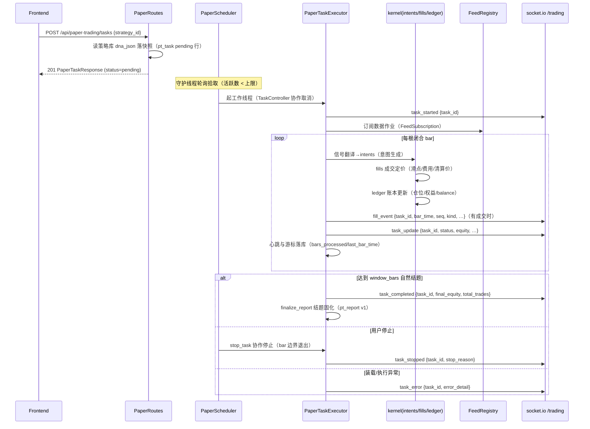

# 模拟纸盘交易流程

## 流程概述
用户创建纸盘任务（上盘：只提交策略编号，DNA 由后端从策略库流转快照），后台调度器守护线程拾取任务并驱动执行器逐 bar 推进：信号翻译产生交易意图，成交定价生成成交记录，账本维护仓位与权益；每根 bar 处理完推送任务状态更新，成交发生时推送成交流水；达到窗口根数自然结题产出报告。全链五态状态机（pending/running/completed/stopped/error），推送经 socket.io /trading 频道七种事件送达前端。

## 触发入口
| 入口 | 类型 | 触发条件 |
|------|------|----------|
| POST /api/paper-trading/tasks | HTTP API | 上盘创建（只收 strategy_id+可选覆写，创建恒 201 返 pending） |
| PaperScheduler._tick() | 后台轮询 | 守护线程每 2 秒拾取 pending 任务（活跃数上限内按创建序） |
| POST /api/paper-trading/tasks/{id}/stop | HTTP API | 停止请求（pending 直接 stopped；running 协作停止于 bar 边界；终态 409） |
| POST /api/paper-trading/tasks/{id}/clone | HTTP API | 克隆重跑（新建 pending 行复制源任务策略与参数） |

## 模块序列


## 数据转换规则
| 节点 | 输入 | 转换逻辑 | 输出 |
|------|------|----------|------|
| PaperRoutes.create_task | PaperTaskCreate（strategy_id+可选覆写） | 读策略库 dna_json 原文落快照；symbol/timeframe 缺省从 DNA 抄录、leverage 缺省取 risk_genes | pt_task 行（status=pending） |
| PaperScheduler | pending 行 | 活跃数守门+created_at 顺序拾取，每任务起工作线程 | running 迁移+执行器实例 |
| PaperTaskExecutor | 任务行+feed 订阅 | 每 bar：信号翻译→意图→成交→账本；心跳/游标落库 | fill_event/task_update 推送+pt_fill/pt_equity 落库 |
| kernel.intents | bar 信号+账户态 | 出入场意图生成（含 SL/TP/trail/分批角色执行） | Intent 序列 |
| kernel.fills | Intent+bar 行情 | 成交定价（滑点/费用；清算价判定） | Fill 记录 |
| kernel.ledger | Fill 序列 | 仓位/权益/balance/资金费累计 | 账本快照+统计组 |
| reporting.build_report | 任务行+明细表 | 滚动报告（任意状态可取；performance/deviation/evidence 三层） | 实时报告 |
| reporting.finalize_report | 终态任务 | 结题固化落 pt_report（版本递增；缺省最新版可取） | 版本化报告 |

## 状态变迁链
```
pending -> running          （调度器拾取）
running -> completed        （达到 window_bars 自然结题）
pending -> stopped          （stop 请求：未拾取直接撤销）
running -> stopped          （stop 请求：协作停止于 bar 边界）
pending/running -> error    （装载或执行异常）

终态吸收：completed/stopped/error 出发的迁移一律拒绝（REST 终态操作 409）
克隆重跑 = 新建 pending 行（非状态迁移）；DELETE 限终态任务
```

数据持久化：
- 任务行：每 bar 心跳/游标（bars_processed/last_bar_time/heartbeat_at）+账户运行态组
- 成交流水：pt_fill（seq 审计编号：清算 1/SL·TP 2/出场 3/入场族 4）
- 权益快照：pt_equity（每 bar）
- 资金费：pt_funding（结算行+终态回补例程补历史缺口）
- 报告：pt_report（结题固化版本化存储）

## 实时推送（socket.io /trading 频道，room=task_id）
七事件：task_started / task_update（每 bar）/ fill_event（成交时）/ task_completed / task_stopped / task_error（含装载失败早退）/ task_snapshot（connect 恢复快照，读新表）。

## 源码锚点
- [api/routes/paper_trading.py:234-266] 上盘创建（strategy_id 流转快照）
- [api/routes/paper_trading.py:293-316] stop 三态分派（REST 只转发，写者=调度器）
- [core/paper_trading/runtime/scheduler.py] PaperScheduler 守护线程（拾取/心跳移交/feed 刷新/终态回补）
- [core/paper_trading/runtime/executor.py] PaperTaskExecutor bar 循环与七事件构造点
- [core/paper_trading/kernel/intents.py / fills.py / ledger.py / account.py] 意图→成交→账本内核
- [core/paper_trading/runtime/feed.py] FeedRegistry/FeedSubscription 共享数据作业
- [core/paper_trading/runtime/recovery.py] 心跳超时任务恢复
- [core/paper_trading/reporting.py] 三层报告（build_report/finalize_report/get_final_report）
- [core/persistence/repository/paper.py] 新五表仓库（pt_task/pt_fill/pt_equity/pt_funding/pt_report）与状态机迁移集
