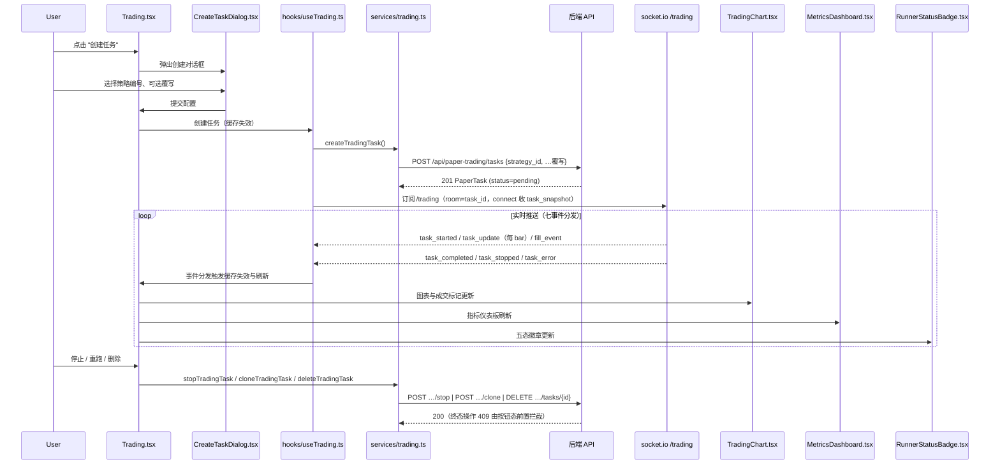

# 模拟交易管理流程

## 流程概述
用户上盘纸盘任务（选择策略编号+可选参数覆写），通过 socket.io /trading 频道实时接收七种事件更新，查看成交明细、权益曲线、资金费三个标签页与三层验证报告，支持停止、克隆重跑、删除操作（终态操作受 409 门槛保护）。

## 触发入口

| 入口 | 类型 | 触发条件 |
|------|------|----------|
| Trading 页面 "创建任务" 按钮 | 用户交互 | 弹出创建对话框：选策略编号+七项可选覆写（初始资金/杠杆/费率/滑点/交易对/窗口根数/止损比例） |
| Trading 页面 "停止" 按钮 | 用户交互 | 任务 pending 或 running 时停止（终态任务按钮置灰——后端 409 门槛） |
| Trading 页面 "重跑" 按钮 | 用户交互 | 终态任务克隆重跑（新建 pending 行复制源任务策略与参数） |
| Trading 页面 "删除" 按钮 | 用户交互 | 终态任务删除（非终态后端 409） |

## 模块序列

## 数据转换规则

| 节点 | 输入 | 转换逻辑 | 输出 |
|------|------|----------|------|
| CreateTaskDialog | 策略编号+七项可选覆写 | 客户端校验（杠杆范围等）后组装创建请求 | PaperTaskCreate body（strategy_id 必填） |
| createTradingTask | PaperTaskCreate | POST 创建纸盘任务 | PaperTask（五态之一） |
| useTrading | /trading 事件流 | 七事件分发：八面触发对应查询缓存失效 | 页面数据刷新信号 |
| listTradingTasks / getTradingTask | 任务查询 | GET 任务列表/详情（五态+运行态组+统计组） | 任务列表/详情 |
| getTradingFills / getTradingEquity / getTradingFunding | 明细分页（limit+offset+has_more） | GET 成交/权益/资金费三个明细端点 | 三个标签页数据 |
| getTradingReport / getTradingFinalReport | 报告查询 | GET 三层报告（滚动）与结题报告（?version 版本标识） | 报告主呈现+二三层折叠+版本标识 |
| TradingChart | 成交流水+权益数据 | 成交标记叠加图表 | 价格走势+信号标记 |
| MetricsDashboard | 任务统计组+报告绩效 | 展示收益/回撤/胜率等指标卡片 | 指标卡片组 |
| RunnerStatusBadge | 任务状态（五态） | 五态映射徽章颜色与文案 | 状态徽章 UI |

## 状态变迁链

后端五态：pending → running → completed / stopped / error（终态吸收；终态操作 409）。

前端按钮态与状态联动：
- pending/running → "停止" 可用；终态 → "重跑"/"删除" 可用、"停止" 置灰
- 运行中实时更新靠七事件驱动（task_update 每 bar 推送权益与统计）
- 推送断连：socket.io 自动重连，connect 时后端补发 task_snapshot 快照恢复现场

## 源码锚点

- [-> web/src/pages/Trading.tsx] 交易管理主页面：任务列表、三标签页、三层报告呈现与操作编排
- [-> web/src/hooks/useTrading.ts] 查询缓存与七事件分发（八面触发缓存失效）
- [-> web/src/services/trading.ts] 纸盘新域十二函数服务层（对接 /api/paper-trading）
- [-> web/src/components/trading/CreateTaskDialog.tsx] 创建对话框：策略编号+七项可选覆写
- [-> web/src/components/trading/TradingChart.tsx] 交易图表：价格走势与成交标记
- [-> web/src/components/trading/MetricsDashboard.tsx] 指标仪表板
- [-> web/src/components/trading/RunnerStatusBadge.tsx] 五态运行徽章
- [-> web/src/realtime/schemas.ts + contract.md] 七事件 zod 契约与字段权威（前端共同权威）
